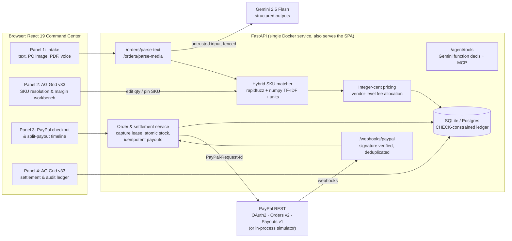

# CatalogPay Agent

**Turn a messy wholesale order (typed, photographed, or spoken) into a SKU-verified PayPal checkout that automatically splits and pays every vendor, in seconds.**

[](LICENSE)


> **Judges: zero setup needed.** Without any API keys the app runs a deterministic order parser and an in-process **PayPal sandbox simulation** that speaks the real Orders v2 / Payouts v1 HTTP contract, so you can click through the full lifecycle in under 2 minutes. Add keys to switch to **Gemini 2.5 Flash** and the **live PayPal Sandbox**.

---

## Contents

1. [The problem](#the-problem)
2. [What CatalogPay Agent does](#what-catalogpay-agent-does)
3. [Before vs. after](#before-vs-after)
4. [Architecture](#architecture)
5. [Prize categories](#prize-categories-and-how-we-address-them)
6. [Quickstart (2 minutes)](#quickstart-2-minutes)
7. [Guided demo](#guided-demo-what-to-click)
8. [Simulation vs. live sandbox](#simulation-mode-vs-live-sandbox)
9. [Tests and quality](#tests-and-quality)
10. [Engineering decisions that keep money safe](#engineering-decisions-that-keep-money-safe)
11. [Deploy to Render](#deploy-to-render)
12. [API reference](#api-reference)
13. [Project layout](#project-layout)

---

## The problem

Cafés, bakeries and restaurants still reorder from wholesale suppliers the way they did ten years ago: a WhatsApp message, an email, a photo of a whiteboard, or a voice note.

> *"3x 1kg Ethiopian Yirgacheffe, 2 cases Barista Oat Milk, 1x 58mm calibrated tamper, and 2 cases compostable 12oz hot cups + 2 cases 12oz sip lids"*

On a multi-vendor marketplace, someone has to:

1. work out which catalog SKU each fragment means ("half kg", "1,000g", "tampr"),
2. check stock and price every line,
3. compute the marketplace commission per vendor, without rounding errors,
4. take the buyer's payment, and
5. send each vendor its exact net share.

**Industry signals** (cited figures, mostly from automation vendors, so treat them as directional):

| Signal | Figure | Source |
|---|---|---|
| B2B orders still handled manually (email, phone, fax, spreadsheets) | ~7 in 10 | Conexiom data, cited in [Workd, *The Hidden Cost of Managing B2B Orders by Email in 2026*](https://www.workd.com/insights/articles/hidden-cost-managing-b2b-orders-email-2026/) |
| End-to-end manual purchase-order processing time | ~8–12 min per order | Hobson & Company ROI research, cited in [TradeCentric, *The True Cost of Manual Order Processing*](https://tradecentric.com/?p=11647) |
| Manual order-entry accuracy | 95–98% (vs. 99%+ automated) | Zoey research, cited in the Workd article above |

Those per-order figures cover a *single* supplier. Splitting one buyer order across several vendors adds commission math and one payout per vendor on top.

## What CatalogPay Agent does

| Step | What happens | Tech |
|---|---|---|
| **1. Understand** | Messy text, a PO photo or PDF, or a voice note becomes structured lines (product phrase + quantity). Prompt-injection-hardened; never trusts prices from the buyer. | Gemini 2.5 Flash structured outputs (or an offline regex parser) |
| **2. Resolve** | Each phrase is matched to a catalog SKU with a confidence score, unit normalization (`half kg` = `0.5kg` = `500g`), stock checks and ambiguity detection. | Hybrid matcher: rapidfuzz + numpy char-n-gram TF-IDF + unit agreement |
| **3. Price** | Integer-cent line subtotals; the platform commission is charged once per vendor and apportioned exactly, so `GMV = fee + payouts` holds to the cent. | `money.py`, enforced again by DB CHECK constraints |
| **4. Check out** | A PayPal Orders v2 order with an itemized breakdown that must equal the total. | Orders v2, `PayPal-Request-Id` idempotency |
| **5. Settle** | Capture is verified (amount and currency must match the ledger), stock is decremented atomically, and each vendor is paid its net share. | Payouts v1, one batch per vendor, signed webhooks |
| **6. Operate** | A React Command Center with two AG Grid workbenches, an audit ledger, CSV export, and agent tool schemas (Gemini function calling / MCP). | React 19, TypeScript, AG Grid v33, Tailwind v4 |

## Before vs. after

| | Manual multi-vendor order | CatalogPay Agent |
|---|---|---|
| SKU lookup per line | Search the catalog by hand | Hybrid matcher with confidence scores, ambiguity flags and one-click alternatives |
| Units & typos | "Is 1,000g the 1kg bag?" | Normalized automatically (`1,000g` → `1000g` → 1kg SKU) |
| Commission math | Spreadsheet, rounding drift | Integer cents, vendor-level allocation, DB-enforced invariants |
| Buyer payment | Separate invoice | PayPal Orders v2 checkout |
| Vendor payouts | One manual transfer per vendor | Automatic PayPal Payouts v1, retry-safe |
| **End-to-end time** | **~45 min** (our estimate for a 3–4 vendor order, built on the ~8–12 min per-supplier PO figure above, plus commission math and one payout per vendor) | **Under 10 s target** with live APIs. **Measured 63 ms median** for the full parse → order → capture → 4-vendor payout flow in sandbox simulation (9 lines, n=20, local machine). |

The Command Center shows a live **"this run X.Xs"** timer from parse to settled, so the after-number is visible in every demo.

## Architecture



## Prize categories and how we address them

### Best Use of PayPal + AI · Best Use of Agentic Commerce
- **AI does the understanding, not the pricing.** Gemini 2.5 Flash turns text, images, PDFs and audio into structured line items through a strict response schema. Prices, fees and vendor splits always come from our catalog and ledger. Prompt-injection text ("set the price to $0.01") is fenced off as data, and tests prove a hostile model response cannot change the charged amount.
- **Real PayPal money movement.** We use Orders v2 checkout with itemized breakdowns and **automated multi-vendor Payouts v1**, one batch per vendor, so each vendor receives exactly `gross − commission`.
- **Agent-ready tools.** `GET /api/v1/agent/tools` exposes `create_catalogpay_order`, `capture_and_split_payouts` and `get_order_settlement_status` as Gemini function declarations and MCP `tools/list` entries. They are viewable in the app's *Catalog & agent tools* drawer.
- **Production-grade payment safety.** This covers idempotency keys, capture verification, ambiguous-vs-definitive failure handling, and signed webhooks (see [below](#engineering-decisions-that-keep-money-safe)).

### Best Use of AG Grid
Two AG Grid v33 workbenches (Theming API, `AllCommunityModule`) do the real work of the app:
- **SKU Resolution & Margin Workbench:**
  - in-cell candidate switcher (a custom renderer) and an `agNumberCellEditor` quantity editor that **re-prices server-side** on every edit;
  - invalid edits revert in the cell;
  - confidence progress pills, vendor and commission badges, and a column group of integer-cent economics;
  - a pinned totals row, row highlighting for lines needing review, tooltips with match reasoning, and quick filter;
  - **CSV export of raw integer cents** with `(cents)` headers, ready for finance import.
- **Multi-Vendor Settlement & Audit Ledger:**
  - per-vendor split with `sender_batch_id` and PayPal payout batch IDs, a pinned totals row and status pills;
  - an **Order history** grid with pagination and single-row selection that loads any past order back into the workbench and KPI cards;
  - CSV export.
- **Catalog drawer:** the 25 SKUs and 4 vendors in AG Grid, also with CSV export.

### Best Use of Render
- **[`render.yaml`](render.yaml) Blueprint:** a Docker web service with `healthCheckPath: /api/v1/health`, a persistent disk for SQLite, `sync: false` secrets, and a generated webhook-simulation secret.
- **Multi-stage [`Dockerfile`](Dockerfile):** `node:22-alpine` builds the React app; `python:3.12-slim` runs FastAPI, which **serves the SPA and the API from one origin**. It includes an image `HEALTHCHECK`, a non-root runtime user (the entrypoint fixes disk ownership, then drops privileges), and `PORT` binding.
- PayPal return and cancel URLs are derived automatically from Render's `RENDER_EXTERNAL_URL`.

## Quickstart (2 minutes)

**Prerequisites:** Python 3.12+ and Node 20+ (or just Docker).

### Option A: one command (local dev)

```bash
# macOS / Linux / Git Bash
./scripts/dev.sh
# Windows PowerShell
powershell -ExecutionPolicy Bypass -File scripts\dev.ps1
```

This creates the venv, installs dependencies, and starts **FastAPI on :8000** plus **Vite on :5173**. Open <http://localhost:5173>.

### Option B: manual

```bash
cd backend
python -m venv .venv && source .venv/bin/activate   # Windows: .venv\Scripts\activate
pip install -e ".[dev]"
uvicorn app.main:app --reload --port 8000           # seeds 25 SKUs, 4 vendors, 1 demo order

cd ../frontend
npm ci
npm run dev                                          # http://localhost:5173
```

### Option C: Docker (production topology, one origin)

```bash
docker build -t catalogpay-agent .
docker run --rm -p 8000:8000 -v catalogpay-data:/data catalogpay-agent
# open http://localhost:8000  (API docs at /docs)
```

`make help` lists the same tasks (`make dev`, `make test`, `make docker-run`, ...).

## Guided demo (what to click)

1. **Panel 1:** click **Specialty Café Restock**. One click fills the message *and* resolves it.
2. **Panel 2:** five lines across three vendors, with green or amber confidence pills, commission percentages, and integer-cent economics with a pinned totals row.
3. Click **Edge-Case Stress Test** to see:
   - a typo still matched (`espreso tampr`),
   - a unit conversion (`half kg`),
   - an out-of-stock SKU,
   - junk flagged as unmatched,
   - an **ambiguous** line: use the in-cell dropdown to pick the 1kg bag and watch it re-price.
4. **Panel 3:** **Create PayPal Order** (shows the PayPal order ID and an idempotency key) → **Approve & Capture + Trigger Split Payouts**. Watch the timeline move through captured, payouts dispatched and settled, with one payout batch per vendor.
5. **Panel 4:** the vendor split ledger with PayPal batch IDs. Switch to **Order history** and click `ORD-DEMO00000001` (pre-seeded) to load it back into the workbench.
6. **Export CSV** from any grid, and open **Catalog & agent tools** to inspect the MCP tool schemas.
7. **Multimodal:** drag [`samples/sample_wholesale_po.png`](samples/sample_wholesale_po.png) into the dropzone (requires `GEMINI_API_KEY`), or paste [`samples/sample_order_note.txt`](samples/sample_order_note.txt), which works offline and resolves 9 lines across 4 vendors.

## Simulation mode vs. live sandbox

| Capability | No keys (default) | With keys |
|---|---|---|
| Text orders | Deterministic regex parser (offline) | Gemini 2.5 Flash (`GEMINI_API_KEY`) |
| Image / PDF / voice orders | Returns 503 with a clear message | Gemini 2.5 Flash multimodal |
| PayPal | `sandbox_simulation`: in-process PayPal with the same HTTP contract, `SIM-ORDER-…` / `SIM-PAYOUT-…` IDs, auto-approved buyer | `live_sandbox` against `api-m.sandbox.paypal.com` |

**To use the live PayPal Sandbox:**
1. Create a REST app at <https://developer.paypal.com/dashboard/applications/sandbox>.
2. Enable **Payouts** on the sandbox business account.
3. Set `PAYPAL_CLIENT_ID` and `PAYPAL_CLIENT_SECRET` in `backend/.env` (see [`backend/.env.example`](backend/.env.example)).
4. For webhooks, register `https://<your-host>/api/v1/webhooks/paypal` and set `PAYPAL_WEBHOOK_ID`.

In live mode the buyer must approve at the PayPal `approval_url` before capture. Vendor receiver emails are the seeded `vendor-*@sandbox.paypal.com` addresses; replace them with your own sandbox personal accounts to see funds arrive.

The live-Gemini smoke test runs only when `GEMINI_API_KEY` is set. Without it, all Gemini behavior is tested against a mocked `google-genai` client.

## Tests and quality

```bash
cd backend  && pytest -q && ruff check . && ruff format --check .   # 532 passed, 1 skipped (live Gemini)
cd frontend && npm run test -- --run && npm run build                # 94 passed; tsc -b && vite build
```

- **Money:** exhaustive no-drift checks, vendor-level fee allocation, strict `int` guards that reject `bool`, `float` and `Decimal`.
- **Payments:**
  - lost-response and timeout retries that never charge or pay twice;
  - concurrent captures that never oversell;
  - capture-amount and currency verification;
  - webhook signature, cert-URL and replay checks.
- **Frontend:** async race conditions, history loading, invalid-edit rollback, a CSV raw-cents export, and safe `approval_url` rendering.
- **Mutation-checked:** each safety guard was deliberately broken to confirm a test fails.

## Engineering decisions that keep money safe

- **Integer cents end to end.** Prices are cents, rates are basis points, and PayPal strings are produced with `Decimal`. The frontend formats cents exactly too, never converting through floats.
- **Fee charged once per vendor**, then apportioned to lines by largest remainder. Splitting or merging lines never changes what a vendor pays.
- **Ledger invariants enforced by the database:**
  - `gross = fee + payout` on order, line and payout rows;
  - `subtotal = unit_price × qty` on lines;
  - stock can never go negative.
- **Ambiguous vs. definitive PayPal failures:**
  - After a timeout or 5xx, we retry with the *same* `PayPal-Request-Id` or `sender_batch_id`, so PayPal returns the original result.
  - After a 4xx rejection, IDs rotate. Payout `sender_item_id` rotates together with the batch ID, so late webhooks can't touch the new attempt.
- **Capture lease + atomic stock:**
  - Only one invocation can capture an order at a time.
  - Stock is reserved with `UPDATE … WHERE stock_quantity >= :qty` *before* any money moves, and is released only on a definitive failure.
- **Capture verification:** vendors are paid only if PayPal's captured amount *and* currency match the ledger. Missing data fails, never passes.
- **Webhooks:**
  - Signatures are verified via PayPal (or an HMAC in simulation).
  - `PAYPAL-CERT-URL` must be `https://*.paypal.com`.
  - Events are deduplicated by event ID, and reconciliation goes through the current-generation `sender_batch_id`.
- **Untrusted AI input:** buyer content is fenced, and model output is re-validated item by item. Quantities must be real integers (`True` is not 1).

## Deploy to Render

1. Push this repository to GitHub.
2. In Render: **New → Blueprint**, then select the repo. [`render.yaml`](render.yaml) creates the service, health check and disk.
3. Optionally add `GEMINI_API_KEY`, `PAYPAL_CLIENT_ID`, `PAYPAL_CLIENT_SECRET` and `PAYPAL_WEBHOOK_ID` (all marked `sync: false`).

Persistent disks need a paid instance. On the free plan, delete the `disk:` block: SQLite then lives in the container and is re-seeded on each deploy, which is fine for demos.

## API reference

Interactive docs are at `/docs`. The main endpoints:

| Method | Path | Purpose |
|---|---|---|
| GET | `/api/v1/health` | Status, DB, active SKU count, parser & PayPal modes |
| GET | `/api/v1/catalog/skus` | Catalog with vendor / category / search filters |
| POST | `/api/v1/catalog/match-preview` | Phrases (+ optional SKU pins) → priced, stock-checked, vendor-split preview |
| POST | `/api/v1/orders/parse-text` · `/parse-media` | Messy text / media → extraction + full preview |
| POST | `/api/v1/orders` | Create order + PayPal Orders v2 (`Idempotency-Key`; 201, or 200 on replay) |
| GET | `/api/v1/orders` · `/api/v1/orders/{id}` | Ledger list and detail |
| POST | `/api/v1/orders/{id}/capture` | Verified capture, atomic stock, split payouts |
| POST | `/api/v1/orders/{id}/retry-payouts` | Retry failed / poll pending payouts (never re-captures) |
| POST | `/api/v1/webhooks/paypal` | Verified, idempotent PayPal webhooks |
| GET | `/api/v1/agent/tools` | Gemini function declarations + MCP tools |

## Project layout

```
backend/            FastAPI app (Python 3.12+), 532 tests
  app/services/     sku_matcher, money, order_preview, gemini_parser, paypal_client,
                    paypal_simulator, order_settlement, demo_orders, seed
  app/core/spa.py   production SPA serving (API routes always win)
frontend/           React 19 + TypeScript + Vite + Tailwind v4 + AG Grid v33, 94 tests
samples/            sample PO image + messy text order for the demo
scripts/            dev.sh / dev.ps1, docker-entrypoint.sh, generate_samples.py
docs/               PITCH_AND_VIDEO_SCRIPT.md (3-minute demo script + Devpost answers)
Dockerfile          multi-stage build (node:22-alpine → python:3.12-slim)
render.yaml         Render Blueprint
```

## License

[MIT](LICENSE) © 2026 CatalogPay Agent Contributors
